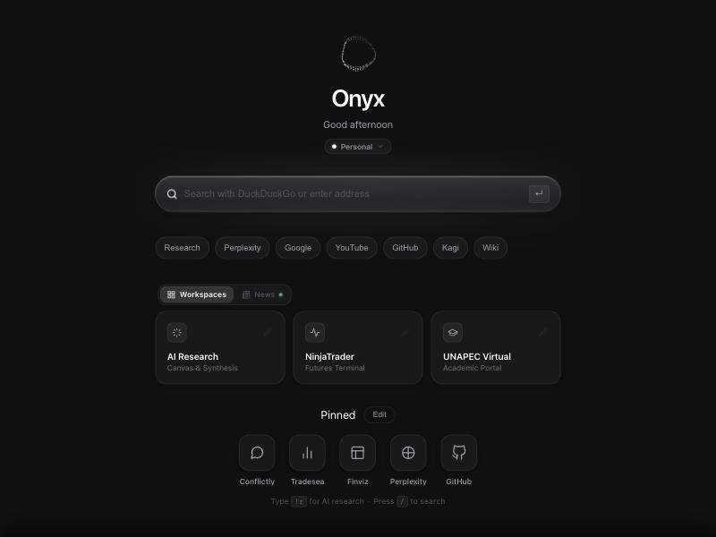
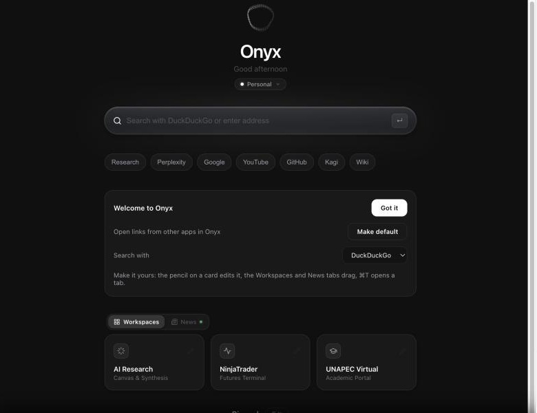

<div align="center">


# Onyx

**A calm, native browser for macOS.** Built on WebKit, with separate workspaces, a password vault and ad blocking, all in a dark interface you can arrange yourself.

[](https://github.com/nnnunezr/onyx/releases/latest)


[Download](https://github.com/nnnunezr/onyx/releases/latest) · [Features](#features) · [Shortcuts](#shortcuts) · [Build](#build-from-source) · [Roadmap](docs/ROADMAP.md)



</div>

## Features

| | |
|---|---|
| **Workspaces** | Each workspace keeps its own cookies and logins, so you can stay signed in to two accounts at once. Switch from the start page or the menu. |
| **Start page you can edit** | Rename or re-point the workspace cards with the pencil, pin your own sites, and drag the Workspaces and News tabs into the order you want. |
| **Tabs that move** | Drag a tab to reorder it, reopen a closed one with ⇧⌘T, and restore your last session from the File menu. |
| **Password vault** | Logins live in the macOS Keychain. Autofill only fills on the saved site and its subdomains, and you can import and export CSV. |
| **Ad and tracker blocking** | Blocks a built-in list of third-party ad and tracker hosts and skips YouTube video ads. One switch in Settings turns it off. |
| **Downloads that show their progress** | A downloads panel with a bar, size and speed per file, and a notice when each one finishes. |
| **Everyday tools** | Find in page, print and save as PDF, per-site zoom, a bookmarks bar, readable error pages, and a right-click menu with the usual links and images actions. |
| **Your search engine** | DuckDuckGo, Google, Brave, Perplexity, Kagi or Bing. Type `!r` on the start page for an AI research chat. |
| **Asks before leaving** | When a page tries to open another app (Zoom, Mail, Slack), Onyx asks first. Script-started launches are dropped. |

<div align="center">

</div>

The first time you open it, a short welcome card lets you make Onyx the default browser and pick a search engine. Bring it back any time from **Onyx > Show Welcome Card**.

## Install

1. Download `Onyx-macOS-arm64.zip` from the [latest release](https://github.com/nnnunezr/onyx/releases/latest), unzip it and drag `Onyx.app` to Applications.
2. The app is signed with a development certificate and is not notarized, so macOS will refuse the first launch. Right-click the app and choose **Open**, or run:

   ```bash
   xattr -cr /Applications/Onyx.app
   ```

3. Optional: **Onyx > Make Onyx Default Browser…**, then approve the macOS prompt.

Requires an Apple silicon Mac on macOS 14 or later.

## Shortcuts

| Keys | Action | Keys | Action |
|---|---|---|---|
| ⌘T | New tab | ⌘F / ⌘G | Find / next match |
| ⌘W | Close tab | ⌘R | Reload |
| ⇧⌘T | Reopen closed tab | ⌘[ / ⌘] | Back / forward |
| ⌘L or ⌘K | Address and search | ⌘D | Add bookmark |
| ⌘J | Downloads | ⇧⌘B | Show or hide bookmarks bar |
| ⇧⌘P | Passwords | ⌘+ / ⌘− / ⌘0 | Zoom in / out / reset |
| ⌘, | Settings | ⌘P / ⌘S | Print / save page |

## Build from source

You need a Mac with the Xcode command line tools (`swiftc`).

```bash
./build.sh                    # builds, signs and installs to ~/Applications
ONYX_NO_INSTALL=1 ./build.sh  # builds and signs in this folder only
tests/run.sh                  # unit tests for the pure logic
```

`build.sh` signs with an Apple Development certificate when it finds one (this keeps Keychain access stable across rebuilds) and falls back to ad-hoc signing. The About box shows the commit a build came from.

## Project

- `Sources/` is the macOS app: one `BrowserController` with an extension per feature, plus small Foundation-only helpers in `Sources/Core/` that the tests cover.
- `startpage.html` and `settings.html` are the start page and settings, shared with the Android app in `android/`. The Android build is experimental and only gets bug fixes.
- [`docs/ROADMAP.md`](docs/ROADMAP.md) is the audited plan. [`docs/WINDOWS.md`](docs/WINDOWS.md) is a plan for a Windows version; nothing is built yet.

There is no license file yet, so all rights are reserved until one is added.
